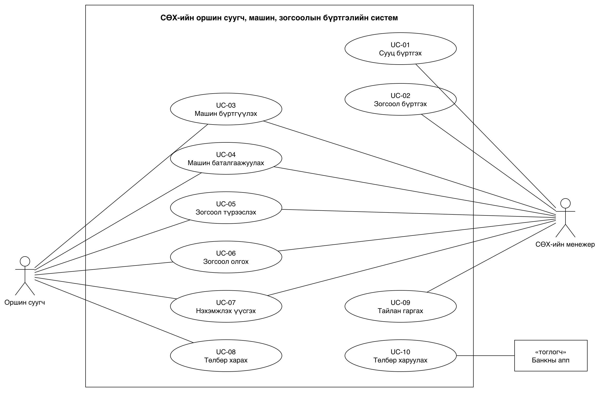
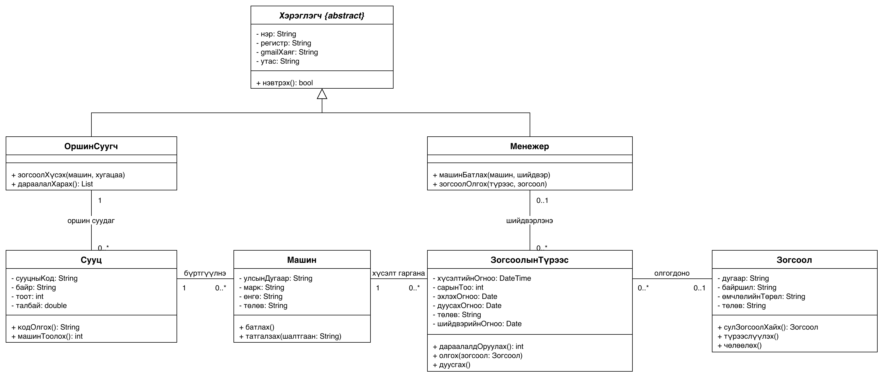
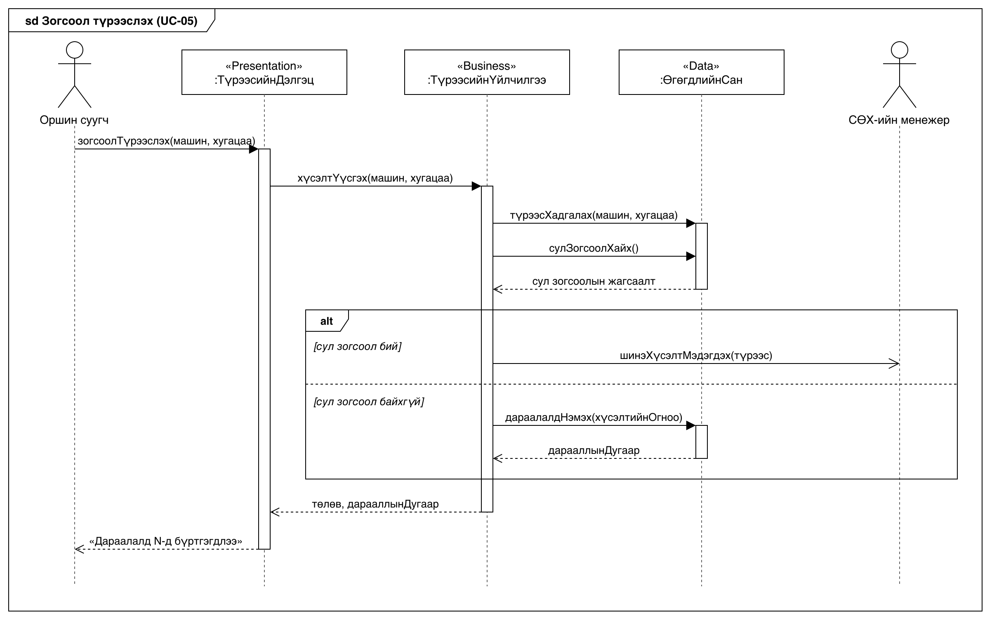
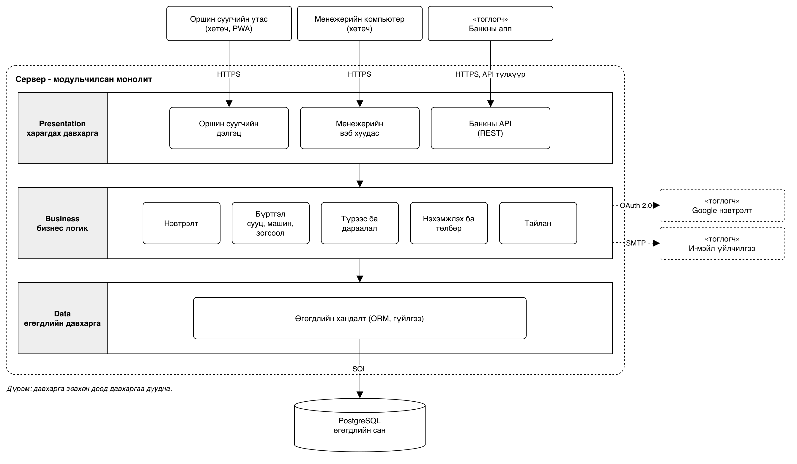

# Лабораторийн ажил №5 — UML диаграм ба архитектурын загвар

Хичээл: Программ хангамж хөгжүүлэлтийн процесс (5-р долоо хоног)\
Төсөл: СӨХ-ийн сууц, машин, зогсоолын бүртгэлийн систем\
Баг: Д.Ууганбаяр (Product Owner), Ц.Номунзаяа (Scrum Master)

> **Шинэчилсэн (2026-10-20):** Лаб 5-ын дараа нэг дэх, нэмэлт машины ангиллыг хассан. Хүсэлтийг зөвхөн ирсэн дарааллаар эрэмбэлнэ. Class, Sequence диаграм ба тайлбарыг үүнд тааруулав.

## 1. Зорилго

- Лаб 2-ын шаардлагаас Use Case, Class, Sequence диаграм зурах.
- Системийн архитектурын эскизийг давхаргат (Layered) хэлбэрээр зурж, сонголтоо үндэслэх.

## 2. Хэрэгсэл

Диаграмуудыг draw.io (diagrams.net) форматаар хийв. Эх файлууд нь `docs/drawio/` хавтсанд: [lab5-usecase.drawio](drawio/lab5-usecase.drawio), [lab5-class.drawio](drawio/lab5-class.drawio), [lab5-sequence.drawio](drawio/lab5-sequence.drawio), [lab5-architecture.drawio](drawio/lab5-architecture.drawio). app.diagrams.net → File → Open from → Device гэж нээгээд засна.

## 3. Use Case диаграм

Тоглогч нь Лаб 2-ын гурван төрлийн хэрэглэгч:

- **Оршин суугч** гар утсаараа машинаа бүртгүүлж, зогсоол түрээслэж, төлбөрөө харна.
- **СӨХ-ийн менежер** сууц, зогсоол бүртгэж, машин баталгаажуулж, зогсоол олгож, нэхэмжлэх, тайлан гаргана.
- **Банкны апп** нь гадаад систем. Сууцны кодоор төлбөрийн дүнг асууж, төлөгдсөн тухай мэдэгдэнэ.

Шугам нь тоглогч тухайн use case-д оролцохыг заана. Жишээ нь UC-06-д менежер зогсоол олгоход оршин суугч мэдэгдэл хүлээн авдаг тул хоёулаа холбогдсон.

Лаб 2-ын story бүр аль use case-д хамаарах:

| Use case | User story |
|---|---|
| UC-01 Сууц бүртгэх | US-02 |
| UC-02 Зогсоол бүртгэх | US-03 |
| UC-03 Машин бүртгүүлэх | US-04 |
| UC-04 Машин баталгаажуулах | US-05 |
| UC-05 Зогсоол түрээслэх | US-06, US-07, US-08 |
| UC-06 Зогсоол олгох | US-10 |
| UC-07 Нэхэмжлэх үүсгэх | US-12 |
| UC-08 Төлбөр харах | US-13 |
| UC-09 Тайлан гаргах | US-15 |
| UC-10 Төлбөр харуулах | US-14 |

US-01 (Gmail-ээр нэвтрэх) нь тусдаа use case биш, бүх use case-ийн өмнөх нөхцөл. US-09 (нэг дэх машиныг түрүүлүүлэх), US-11 (дарааллаас гадуур олголтын шалтгаан) нь хасагдсан дүрэм тул use case-д холбоогүй.

## 4. Class диаграм

Системийн үндсэн таван объектыг сонгов: **Хэрэглэгч, Сууц, Машин, ЗогсоолынТүрээс, Зогсоол**. Хэрэглэгч нь хийсвэр (abstract) класс бөгөөд ОршинСуугч, Менежер хоёр түүнээс удамшина.

| Класс | Үүрэг |
|---|---|
| Хэрэглэгч | Gmail-ээр нэвтэрдэг бүх хэрэглэгчийн нийтлэг өгөгдөл. Өөрөөсөө шууд объект үүсгэхгүй. |
| ОршинСуугч | Зогсоол хүсэж, дарааллаа харна. |
| Менежер | Машин баталгаажуулж, зогсоол олгоно. |
| Сууц | Сууцны код, байр, тоот, талбай. Бүртгэлтэй машиныхаа тоог хариулна. |
| Машин | Улсын дугаар, марк, өнгө, төлөв. Менежер баталгаажуулсан машинд л зогсоол хүснэ. |
| ЗогсоолынТүрээс | Хүсэлтээс дуусах хүртэлх нэг машины түрээс. Хүсэлтийн огноо, хугацаа, төлөвийг хадгална. Дараалал хүсэлтийн огноогоор эрэмбэлэгдэнэ. |
| Зогсоол | Дугаар, байршил, өмчлөлийн төрөл (дундын, хувийн), төлөв. |

Холбоо ба үржвэр:

- **Удамшил:** ОршинСуугч, Менежер → Хэрэглэгч (хоосон гурвалжин сум).
- **ОршинСуугч 1 — 0..\* Сууц:** сууц бүр яг нэг хариуцах оршин суугчтай, харин нэг хүн хоёр сууцтай байх тохиолдол бий.
- **Сууц 1 — 0..\* Машин:** сууц машингүй ч, хэд хэдэн машинтай ч байна.
- **Машин 1 — 0..\* ЗогсоолынТүрээс:** түрээс тодорхой машинд зориулагдана. Цаг хугацааны явцад нэг машин олон түрээстэй ч нэгэн зэрэг нэг л идэвхтэй түрээстэй.
- **Менежер 0..1 — 0..\* ЗогсоолынТүрээс:** хүлээгдэж буй хүсэлтэд шийдвэр гаргасан менежер хараахан байхгүй.
- **ЗогсоолынТүрээс 0..\* — 0..1 Зогсоол:** дараалалд байгаа хүсэлт зогсоолгүй, олгогдсоны дараа нэг зогсоолтой. Нэг зогсоол цаг хугацааны явцад олон түрээстэй.

Нэхэмжлэх, Төлбөр классыг лабын «4–5 объект» гэсэн шаардлагын дагуу энэ диаграмд оруулаагүй.

## 5. Sequence диаграм — Зогсоол түрээслэх

Энэ нь US-06, US-07-ийн урсгал. Оролцогчид нь архитектурын гурван давхаргатай таарна.

1. Оршин суугч зогсоолгүй машинаа, хугацаагаа сонгож хүсэлт илгээнэ.
2. Дэлгэц хүсэлтийг үйлчилгээ рүү дамжуулна.
3. Үйлчилгээ түрээсийг «Хүлээгдэж буй» төлөвтэй хадгалж, сул зогсоол хайна.
4. **alt** хэсэг: сул зогсоол байвал менежерт мэдэгдэл илгээнэ. Байхгүй бол хүсэлтийг дараалалд нэмж, дарааллын дугаар авна. Дараалал зөвхөн хүсэлтийн огноогоор эрэмбэлэгдэнэ.
5. Дэлгэц оршин суугчид дарааллын дугаарыг харуулна.

Тэмдэглэгээ: бүтэн сум нь дуудлага, тасархай сум нь хариу, нээлттэй сум нь хариу хүлээхгүй (асинхрон) мессеж, нарийн тэгш өнцөгт нь объект ажиллаж буй хугацаа.

## 6. Архитектурын эскиз

Давхаргат (Layered) архитектур — нэг сервер дээр ажиллах нэг програм:

- **Presentation:** оршин суугчийн утасны дэлгэц (PWA), менежерийн вэб хуудас, банкны API.
- **Business:** таван модуль — Нэвтрэлт, Бүртгэл, Түрээс ба дараалал, Нэхэмжлэх ба төлбөр, Тайлан.
- **Data:** өгөгдлийн хандалт ба PostgreSQL өгөгдлийн сан.

Давхарга зөвхөн доод давхаргаа дуудна. Утас, компьютер, банкны апп нь клиент, програм нь сервер тул бүхэлдээ клиент-сервер хэлбэртэй. Гадаад үйлчилгээ нь Google нэвтрэлт ба и-мэйл. PostgreSQL бол санал болгож буй сонголт, хэрэгжүүлэхээс өмнө багаараа эцэслэнэ.

### Үндэслэл

Баг хоёр хүнтэй тул олон жижиг сервис тусад нь байршуулж удирдахаас нэг програмыг давхаргаар хуваах нь хурдан, алдаа багатай. Нэг СӨХ хэдэн зуун сууцтай тул нэг сервер хангалттай бөгөөд ачаалал өсвөл програмыг хэд хэдэн сервер дээр хувилж, нэг өгөгдлийн санг хуваалцуулна. Зогсоол олгохдоо «сул эсэхийг шалгах» ба «олгох» хоёрыг нэг өгөгдлийн сангийн гүйлгээнд хийснээр нэг зогсоолыг хоёр сууцад олгохоос сэргийлнэ, энэ нь нэг өгөгдлийн сантай бүтцэд хамгийн энгийн. Давхаргууд тусдаа тул дэлгэцийг, жишээ нь гар утасны апп болгож солиход бизнес логик, өгөгдлийн хэсэг өөрчлөгдөхгүй.

## 7. Дүгнэлт

Лаб 2-ын 15 story-гоос 3 тоглогч, 10 use case-тэй Use Case диаграм, 5 үндсэн объект ба удамшилтай Class диаграм, «Зогсоол түрээслэх» урсгалын Sequence диаграмыг draw.io-д зурав. Sequence диаграмын оролцогчид архитектурын давхаргатай нийцнэ. Хоёр хүнтэй баг, нэг СӨХ-ийн ачаалал, зогсоолыг давхар олгохоос сэргийлэх шаардлагад тулгуурлан давхаргат монолит архитектурыг сонгов.

## Биелэлтийн шалгуур

- [x] Диаграмыг draw.io форматаар хийсэн (эх файл `docs/drawio/`)
- [x] Use Case: Лаб 2-ын хэрэглэгчид тоглогч болж, 10 use case-тэй холбогдсон
- [x] Class: 5 үндсэн объект, attribute, method, association, inheritance
- [x] Sequence: нэг гол урсгал, хэрэглэгч → систем → өгөгдлийн сан
- [x] Архитектурын эскиз (Layered) ба 3–4 өгүүлбэр үндэслэл
- [x] Бүгдийг нэг PDF болгосон
