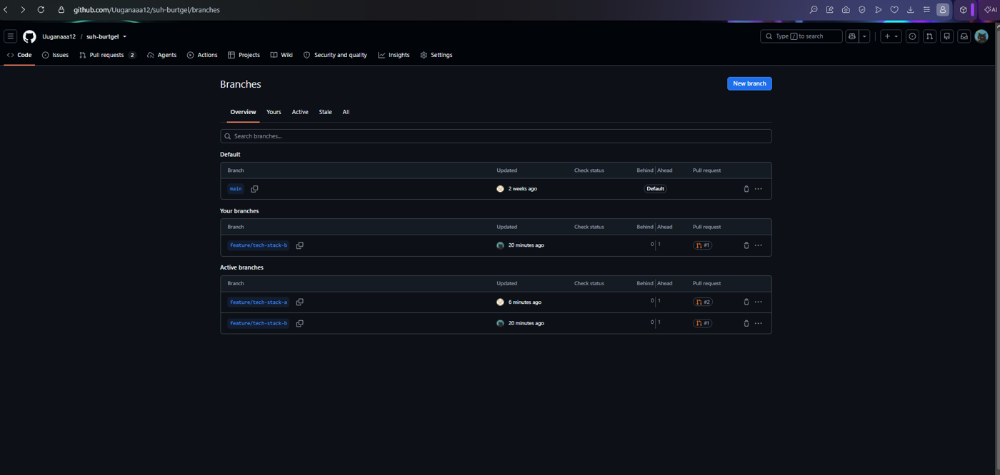
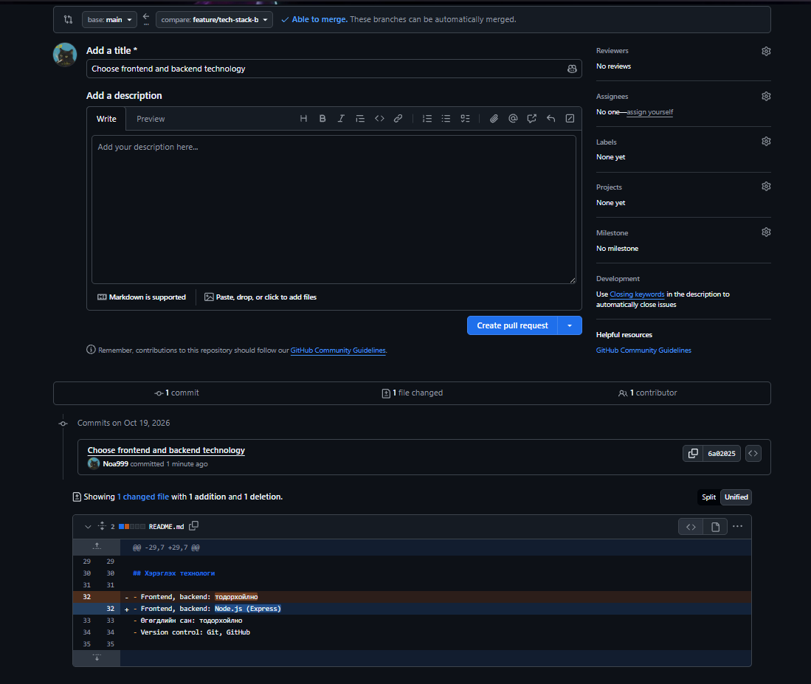
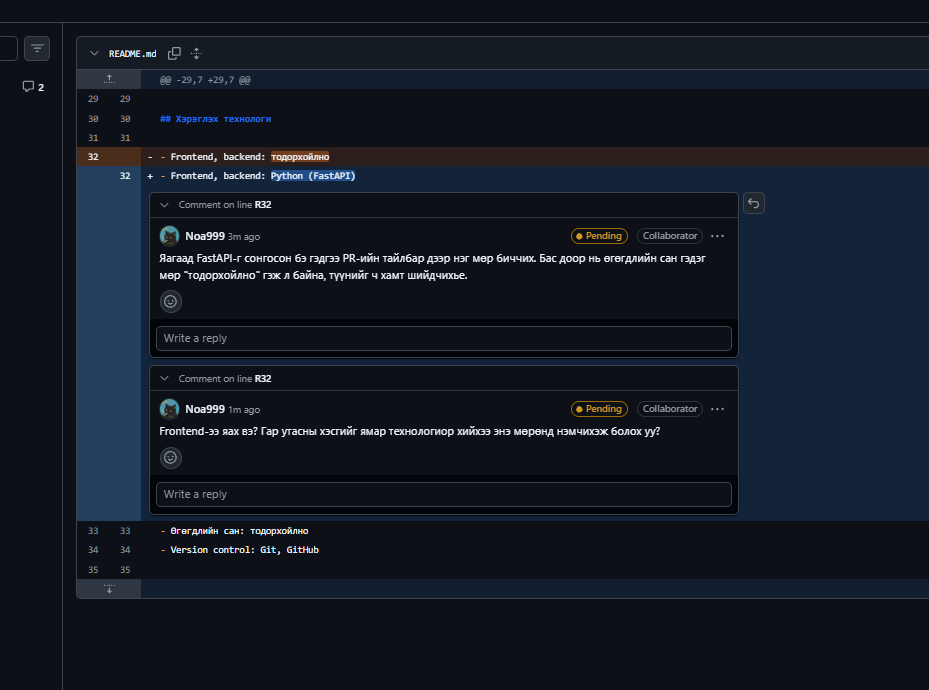
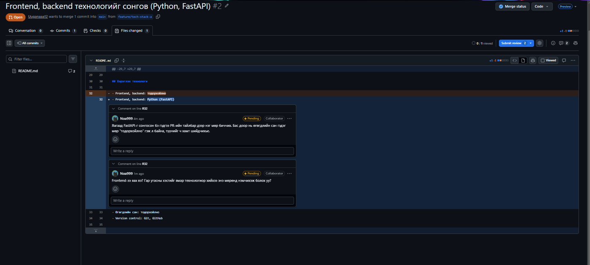
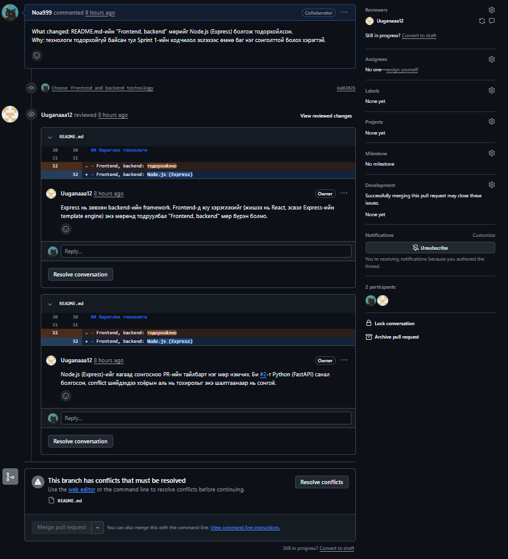
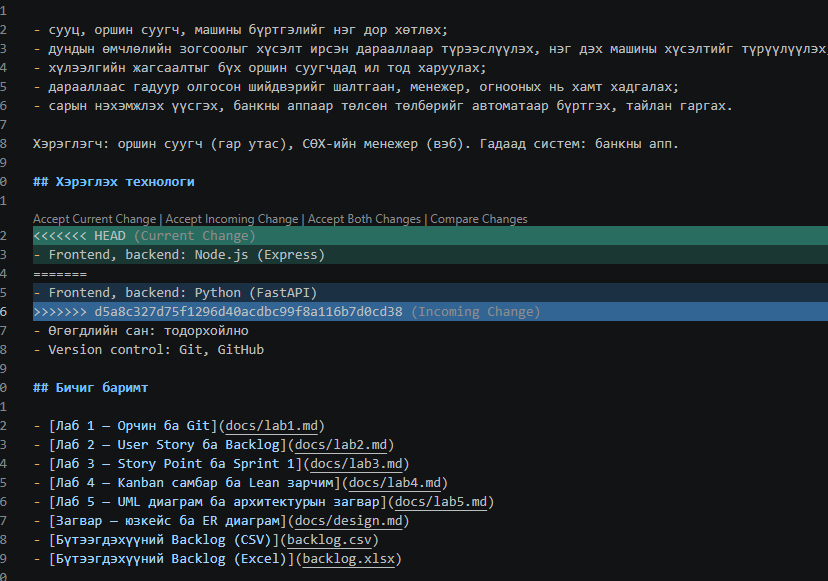
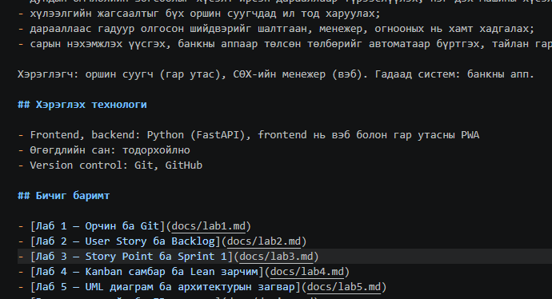
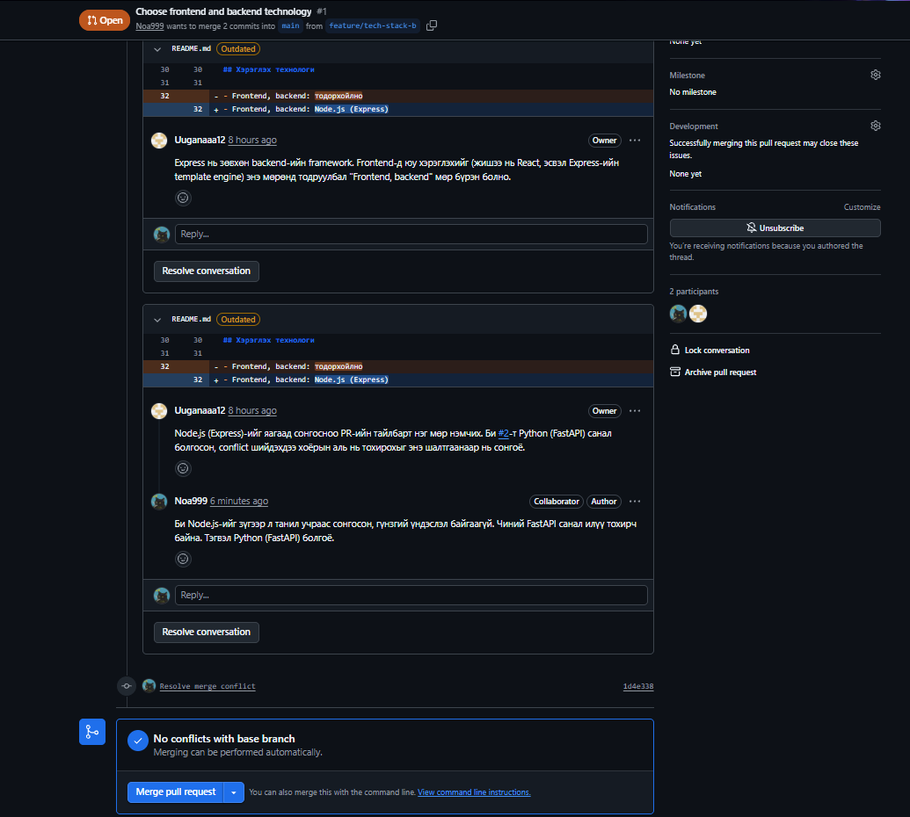
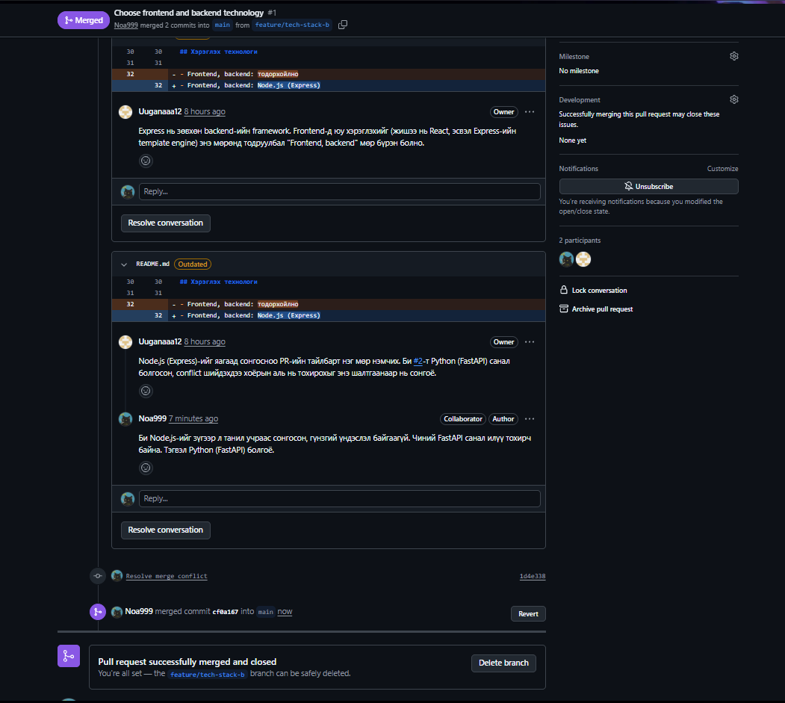
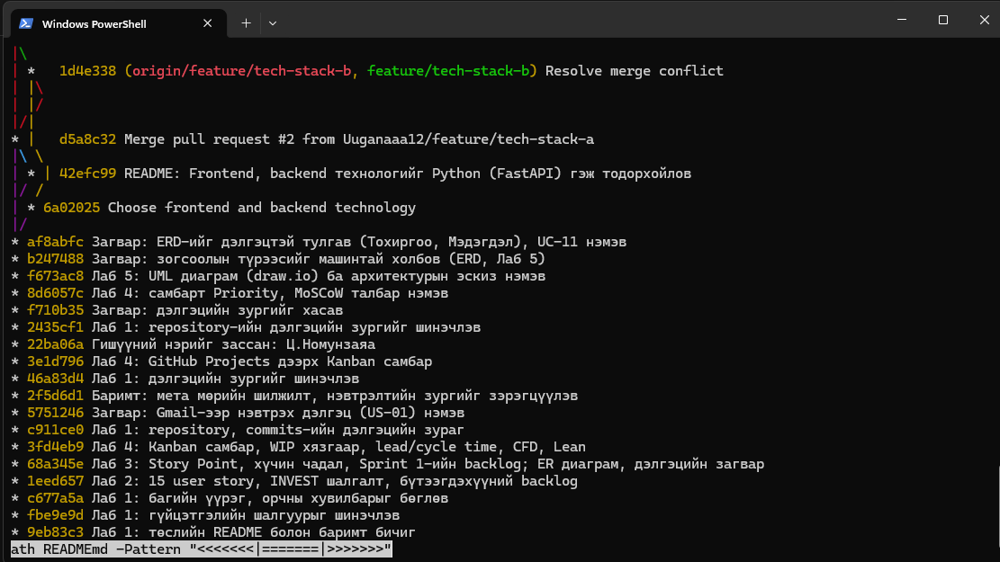

# Лабораторийн ажил №6 — Git Branching, Merge Conflict, Code Review

Хичээл: Программ хангамж хөгжүүлэлтийн процесс (6-р долоо хоног)\
Төсөл: СӨХ-ийн сууц, машин, зогсоолын бүртгэлийн систем\
Баг: Д.Ууганбаяр (Product Owner), Ц.Номунзаяа (Scrum Master)\
Repository: <https://github.com/Uuganaaa12/suh-burtgel>

## 1. Зорилго

- Feature branch үүсгэж, ажиллаад `main` руу нэгтгэх.
- Санаатайгаар merge conflict үүсгэж, шийдвэрлэх.
- Pull Request үүсгэж, хосоороо code review хийх.

Дадлагын сэдэв нь README-ийн «Хэрэглэх технологи» хэсгийн `Frontend, backend: тодорхойгүй` мөр байв. Энэ нь манай төсөлд үнэхээр шийдэх ёстой асуудал тул хоёулаа өөр өөр технологи санал болгож, review-ээр сонголтоо үндэслэв.

## 2. Ажлын хуваарилалт

| Гишүүн | GitHub | Branch | Санал болгосон технологи | PR | Review хийсэн PR |
|---|---|---|---|---|---|
| Д.Ууганбаяр | `Uuganaaa12` | `feature/tech-stack-a` | Python (FastAPI) | #2 | #1 (Номунзаяагийн) |
| Ц.Номунзаяа | `Noa999` | `feature/tech-stack-b` | Node.js (Express) | #1 | #2 (Ууганбаярын) |

README.md-ийн 32-р мөр хоёр branch дээр өөр өөр өөрчлөгдсөн тул conflict гарах нөхцөл бүрдсэн.



## 3. Feature branch ба Pull Request

Хоёулаа `main`-аас тусдаа branch салгаж, README.md-ийн 32-р мөрийг өөрчлөөд push хийв.

```bash
git checkout -b feature/tech-stack-b
git add README.md
git commit -m "Choose frontend and backend technology"
git push origin feature/tech-stack-b
```

Дараа нь GitHub дээр **New pull request** дарж branch бүрээс `main` руу PR үүсгэв.

| PR | Гарчиг | Branch | Commit |
|---|---|---|---|
| #2 | Frontend, backend технологийг сонгов (Python, FastAPI) | `feature/tech-stack-a` | `42efc99` |
| #1 | Choose frontend and backend technology | `feature/tech-stack-b` | `6a02025` |



## 4. Code Review

Хос бүр нэг нэгнийхээ PR дээр хоёр comment бичсэн. Нийт 4 comment.

### PR #2 (Ууганбаярын) дээр Номунзаяа бичсэн

1. «Яагаад FastAPI-г сонгосон бэ гэдгээ PR-ийн тайлбар дээр нэг мөр бичиж. Бас доор нь өгөгдлийн сан гэдэг мөр "тодорхойгүй" гэж л байна, түүнийг ч хамт шийдчихье.»
2. «Frontend-ээ яах вэ? Гар утасны хэсгийг ямар технологиор хийхээ энэ мөрөнд нэмчихэж болох уу?»





### PR #1 (Номунзаяагийн) дээр Ууганбаяр бичсэн

1. Express нь зөвхөн backend-ийн framework. Frontend-д юу хэрэглэхийг (жишээ нь React, эсвэл Express-ийн template engine) энэ мөрөнд тодруулбал «Frontend, backend» мөр бүрэн болно.
2. Node.js (Express)-ийг яагаад сонгосноо PR-ийн тайлбарт нэг мөр нэмэх. PR #2-т Python (FastAPI) санал болгосон тул conflict шийдэхдээ хоёрын аль нь тохирохыг энэ шалтгаанаар сонгоно.

Номунзаяа хариуд Node.js-ийг зүгээр л танил учраас сонгосон, гүнзгий үндэслэл байхгүй гэдгээ хүлээн зөвшөөрч, FastAPI илүү тохирох тул Python (FastAPI) болгохоор тохиролцсон.



## 5. Merge Conflict

PR #2 эхэлж `main` руу нэгтгэгдсэн (merge commit `d5a8c32`). Үүний дараа `feature/tech-stack-b` branch `main`-ээс хоцорч, PR #1 дээр GitHub «This branch has conflicts that must be resolved» гэж харуулсан.

Conflict-ийг локал дээр шийдэхийн тулд `main`-ийг өөрийн branch руу татав:

```bash
git checkout feature/tech-stack-b
git pull origin main
# CONFLICT (content): Merge conflict in README.md
```

README.md-д conflict marker гарсан:

```text
<<<<<<< HEAD
- Frontend, backend: Node.js (Express)
=======
- Frontend, backend: Python (FastAPI)
>>>>>>> d5a8c327d75f1296d40acdbc99f8a116b7d0cd38
```

- `<<<<<<< HEAD` ба `=======`-ийн хооронд манай branch-ийн хувилбар (Node.js).
- `=======` ба `>>>>>>>`-ийн хооронд `main`-ий хувилбар (Python).



Review дээр тохирсны дагуу Python (FastAPI)-г үлдээж, marker-уудыг устгав. Frontend нь вэб болон гар утасны PWA гэдэг нь мөрөнд бичигдсэн:

```text
- Frontend, backend: Python (FastAPI), frontend нь вэб болон гар утасны PWA
```



Дараа нь resolve commit үүсгэж push хийв:

```bash
git add README.md
git commit -m "Resolve merge conflict"
git push origin feature/tech-stack-b
```

Үр дүнд `1d4e338` commit PR #1-д нэмэгдэж, GitHub «No conflicts with base branch» гэж харуулсан. Ингэж marker үлдээгүйг `Select-String -Path README.md -Pattern "<<<<<<<|=======|>>>>>>>"` командаар шалгасан (гаралт хоосон).



## 6. Merge хийх

PR #1-ийг **Merge pull request** → **Confirm merge** гэж нэгтгэв. PR нь **Merged** төлөвтэй болсон.



`main`-ийг татаж, түүхийг шалгав:

```bash
git checkout main
git pull origin main
git log --oneline --graph
```



| PR | Гишүүн | Төлөв | Merge commit |
|---|---|---|---|
| #2 | Д.Ууганбаяр | Merged | `d5a8c32` |
| #1 | Ц.Номунзаяа | Merged | `cf0a167` |

Түүхэнд `42efc99`, `6a02025` (хоёр feature commit), `1d4e338` (conflict засвар), `d5a8c32`, `cf0a167` (merge commit-ууд) харагдана.

## 7. Эцсийн үр дүн

`main` дээрх README.md-ийн 32-р мөр: `Frontend, backend: Python (FastAPI), frontend нь вэб болон гар утасны PWA`. Хоёр branch бүгд `main` руу нэгтгэгдсэн.

## 8. Дүгнэлт

Хоёр тусдаа branch дээр ижил мөрийг өөрчилснөөр conflict үүсэхийг бодитоор үзэв. Conflict marker-ийн утгыг ойлгож, зөвхөн кодын түвшинд биш, review дээр тохирсон шалтгаанаар (FastAPI нь манай Python-д суурилсан архитектурт тохирно) хувилбар сонгосон. Review нь зүгээр нэг шалгалт биш, технологийн сонголтыг үндэслэхэд тусалсан: Node.js-ийг «танил учраас» сонгосон нь хангалтгүй үндэслэл болохыг review-ээр илрүүлсэн. Цаашид PR-ийн тайлбарт сонголтынхоо шалтгааныг эхнээс нь бичнэ, мөн ажил эхлэхийн өмнө `git pull origin main` хийж conflict-оос эрт сэргийлнэ.

## Биелэлтийн шалгуур

- [x] 2 тусдаа feature branch үүсгэсэн (`feature/tech-stack-a`, `feature/tech-stack-b`)
- [x] Санаатайгаар merge conflict үүсгэж шийдвэрлэсэн (README.md, 32-р мөр, `1d4e338`)
- [x] Хоёулаа нэг нэгнийхээ PR дээр 2 comment бичиж review хийсэн
- [x] Бүх branch `main` руу амжилттай merge хийгдсэн (PR #2, PR #1)
- [x] Commit түүх, PR, comment-үүд GitHub дээр харагдана
