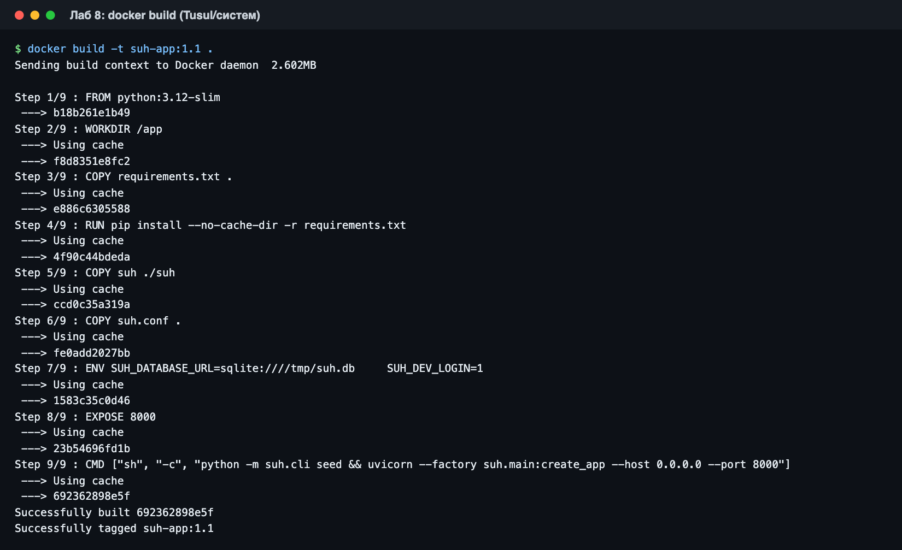
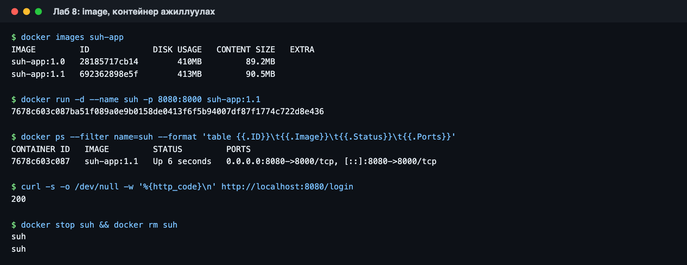
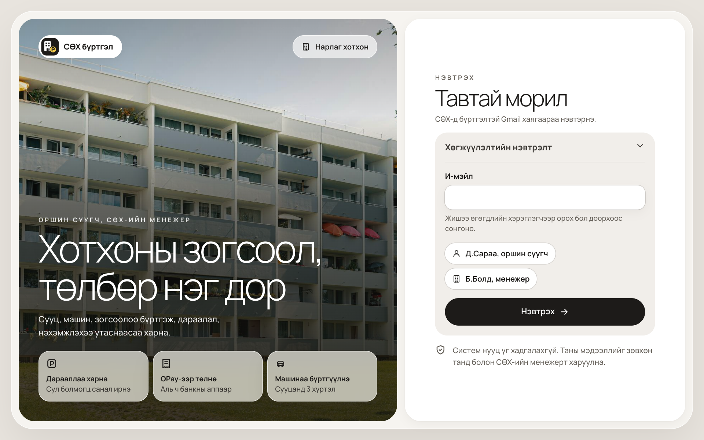

# Лабораторийн ажил №8: Аппыг Docker image болгох

Хичээл: Программ хангамж хөгжүүлэлтийн процесс\
Төсөл: СӨХ-ийн сууц, машин, зогсоолын бүртгэлийн систем\
Баг: Д.Ууганбаяр (Product Owner), Ц.Номунзаяа (Scrum Master)\
Repository: <https://github.com/Uuganaaa12/suh-burtgel>

## 1. Зорилго

- СӨХ системийн вэб аппыг (FastAPI) Docker image болгон багцлах.
- Image-ээс контейнер ажиллуулж, апп хариу өгч байгааг шалгах.
- Лаб 9-д Kubernetes дээр ажиллуулах image-ийг бэлдэх.

Контейнер нь апп, түүний Python хувилбар, сангуудыг нэг багц болгодог. Иймд «миний компьютер дээр ажилладаг» асуудал арилж, хөгжүүлэгчийн компьютер, CI, сервер дээр апп адилхан ажиллана.

## 2. Dockerfile

Аппын код (`suh/` багц, `suh.conf`, `requirements.txt`) хөгжүүлэлтийн хавтсанд байгаа бөгөөд Dockerfile тэр хавтасны үндсэнд байна.

```dockerfile
FROM python:3.12-slim
WORKDIR /app
COPY requirements.txt .
RUN pip install --no-cache-dir -r requirements.txt
COPY suh ./suh
COPY suh.conf .
ENV SUH_DATABASE_URL=sqlite:////tmp/suh.db \
    SUH_DEV_LOGIN=1
EXPOSE 8000
CMD ["sh", "-c", "python -m suh.cli seed && uvicorn --factory suh.main:create_app --host 0.0.0.0 --port 8000"]
```

`.dockerignore`:

```
.venv
__pycache__
tests
```

| Мөр | Юу хийх | Яагаад ингэсэн, юутай харьцуулсан |
|---|---|---|
| `FROM python:3.12-slim` | Суурь image | Бүтэн `python:3.12` image-д хөрвүүлэгч, баримт бичиг зэрэг аппад хэрэггүй зүйл олон тул хэд дахин том. `alpine` илүү жижиг ч glibc-ийн оронд musl ашигладаг тул бэлэн wheel-гүй сан эх кодоос хөрвүүлэгдэж build удаашрах, `uvicorn[standard]`, `psycopg-binary` зэрэг C хэсэгтэй сан дээр асуудал гарах эрсдэлтэй. Иймд `slim`-ийг сонгов. CI-тай ижил Python 3.12. |
| `COPY requirements.txt` → `RUN pip install` → `COPY suh` | Эхлээд сан, дараа нь код | Docker давхарга (layer) бүрийг кэшлэдэг. Код л өөрчлөгдвөл сан суулгах алхам кэшээс авагдаж build хэдхэн секунд болно. Бүх файлыг нэг дор хуулбал код өөрчлөгдөх бүрт сангууд дахин суулгагдана. |
| `--no-cache-dir` | pip-ийн кэшийг image-д үлдээхгүй | Image жижиг болно |
| `ENV SUH_DATABASE_URL=sqlite:////tmp/suh.db` | Контейнер дотор SQLite | Үзүүлэх (demo) image тусдаа өгөгдлийн сангийн серверээс хамааралгүй асах ёстой. Жинхэнэ орчинд PostgreSQL-ийн хаягийг гаднаас нь (`-e` эсвэл Kubernetes Secret) өгнө. |
| `EXPOSE 8000` | Портыг баримтжуулна | Портыг өөрөө нээдэггүй, нээх нь `docker run -p` |
| `CMD ... seed && uvicorn --host 0.0.0.0` | Жишээ өгөгдөл үүсгээд апп асаана | `127.0.0.1` дээр асвал контейнерын гаднаас хандах боломжгүй тул `0.0.0.0` |
| `.dockerignore` | `.venv`, кэш, тестийг хасна | macOS-ийн `.venv` Linux контейнерт ажиллахгүй бөгөөд том. Тест production image-д хэрэггүй. |

## 3. Image бүтээх

```sh
docker build -t suh-app:1.1 .
```



9 алхам бүгд кэшээс авагдсан (`Using cache`) тул build хэдхэн секундэд дуусав.

Хувилбарыг tag-аар ялгав:
- `1.0` бол анхны хувилбар;
- `1.1` бол хэрэглэгчийн интерфейсийн шинэчлэлт.

`latest` tag ашиглаагүй шалтгаан нь Лаб 9-д Kubernetes аль хувилбар ажиллаж байгааг яг мэдэх, буцаах (rollback) боломжтой байх.

## 4. Контейнер ажиллуулах

```sh
docker images suh-app
docker run -d --name suh -p 8080:8000 suh-app:1.1
docker ps
curl -s -o /dev/null -w '%{http_code}\n' http://localhost:8080/login
docker stop suh && docker rm suh
```



`-p 8080:8000` нь компьютерын 8080 портыг контейнерын 8000 порт руу холбоно. Нэвтрэх хуудас 200 буцааж, браузерт нээгдэв:



## 5. Дүгнэлт ба сайжруулах зүйл

СӨХ системийн апп нэг командаар ямар ч Docker-тэй компьютер дээр асдаг болов. Энэ image-ийг Лаб 9-д Kubernetes дээр 3 хувь болгон ажиллуулна.

| Сул тал | Сайжруулах арга |
|---|---|
| Контейнер root эрхээр ажилладаг | `USER` мөр нэмж энгийн хэрэглэгчээр ажиллуулах |
| Image 413MB, дотор нь тестийн `pytest` сан ч суусан | Ажиллахад болон тестэд хэрэгтэй сангуудыг тусдаа файлд салгах, multi-stage build хийх |
| Контейнерыг устгахад SQLite-ийн өгөгдөл устна | Volume эсвэл тусдаа PostgreSQL ашиглах |
| Тохиргоо image дотор (`ENV`) | Ажиллуулах үед `-e` эсвэл Kubernetes ConfigMap, Secret-ээр өгөх |
