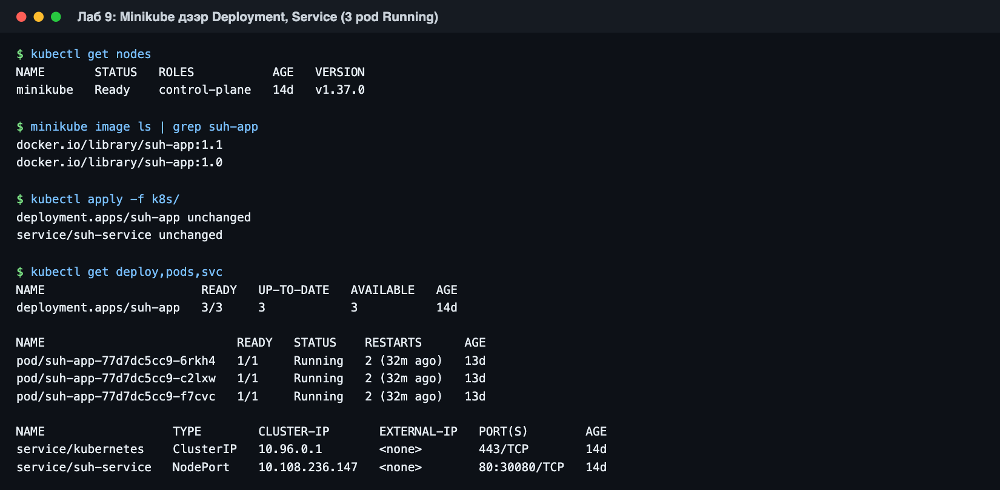
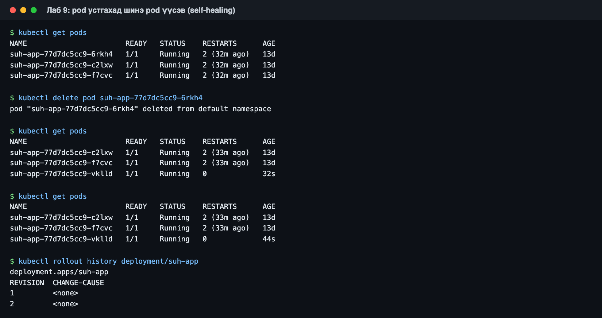
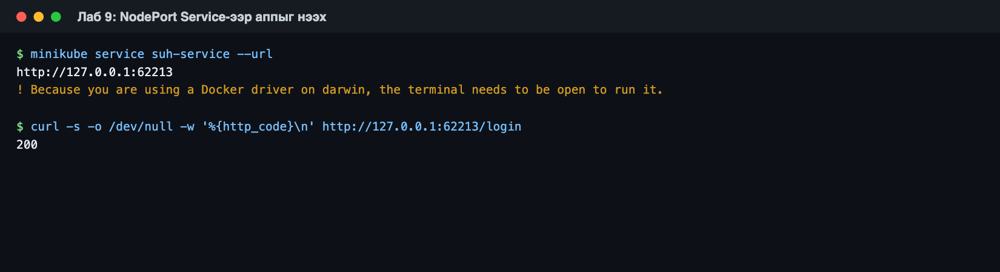

# Лабораторийн ажил №9: Kubernetes (Minikube) дээр Deployment, Service

Хичээл: Программ хангамж хөгжүүлэлтийн процесс\
Төсөл: СӨХ-ийн сууц, машин, зогсоолын бүртгэлийн систем\
Баг: Д.Ууганбаяр (Product Owner), Ц.Номунзаяа (Scrum Master)\
Repository: <https://github.com/Uuganaaa12/suh-burtgel>

## 1. Зорилго

- Лаб 8-ын `suh-app` image-ийг Minikube cluster дээр 3 хувь (replica) болгон ажиллуулах.
- Pod унавал Kubernetes өөрөө шинээр үүсгэдгийг (self-healing) шалгах.
- Service ашиглан аппыг cluster-ийн гадна нэг тогтмол хаягаар гаргах.

## 2. Бэлтгэл

```sh
minikube start
minikube image load suh-app:1.1   # Лаб 8-ын image-ийг cluster руу ачаална
kubectl get nodes
```

Image Docker Hub зэрэг registry-д байршаагүй тул `minikube image load`-оор cluster дотор шууд ачаалав. Registry-д push хийх нь багийн бүх гишүүнд, жинхэнэ серверт хэрэгтэй. Харин нэг компьютер дээрх Minikube-д энэ нь илүү алхам болно.

## 3. Manifest файлууд

Файлууд [`k8s/`](../k8s) хавтсанд байна.

### 3.1. `k8s/deployment.yaml`

```yaml
apiVersion: apps/v1
kind: Deployment
metadata:
  name: suh-app
spec:
  replicas: 3
  selector:
    matchLabels:
      app: suh-app
  template:
    metadata:
      labels:
        app: suh-app
    spec:
      containers:
        - name: suh-app
          image: suh-app:1.1
          imagePullPolicy: Never
          ports:
            - containerPort: 8000
          readinessProbe:
            httpGet:
              path: /login
              port: 8000
            initialDelaySeconds: 5
            periodSeconds: 5
```

| Талбар | Утга | Яагаад |
|---|---|---|
| `replicas: 3` | Үргэлж 3 pod барина | 1 pod байвал унах үед апп бүрэн зогсоно. 3 pod байвал нэг нь унахад нөгөө хоёр нь хүсэлт хүлээн авсаар байна. |
| `selector`, `labels: app: suh-app` | Deployment өөрийн pod-уудыг label-ээр олно | Service ч мөн энэ label-ээр pod-уудаа олдог |
| `image: suh-app:1.1` | Лаб 8-ын image | Тодорхой хувилбар тул аль код ажиллаж байгаа нь мэдэгдэнэ |
| `imagePullPolicy: Never` | Registry-ээс татахгүй | Image зөвхөн cluster дотор ачаалагдсан тул татахыг оролдвол pod `ErrImagePull` болно |
| `readinessProbe` (`/login`) | Апп хариу өгч эхэлсний дараа л хүсэлт илгээнэ | Контейнер асаад жишээ өгөгдөл үүсгэх хооронд хүсэлт ирвэл алдаа гарна. `/login` нь нэвтрэлт шаардахгүй тул 200 буцаавал апп бэлэн гэж үзнэ. |

### 3.2. `k8s/service.yaml`

```yaml
apiVersion: v1
kind: Service
metadata:
  name: suh-service
spec:
  type: NodePort
  selector:
    app: suh-app
  ports:
    - port: 80
      targetPort: 8000
      nodePort: 30080
```

| Порт | Утга |
|---|---|
| `port: 80` | Service-ийн cluster доторх порт |
| `targetPort: 8000` | Контейнер дотор uvicorn ажиллаж буй порт |
| `nodePort: 30080` | Node дээрх порт, cluster-ийн гаднаас хандана |

Pod устаж шинээр үүсэх бүрт IP хаяг нь солигддог. Service тогтмол нэг хаяг өгч, `app: suh-app` label-тэй pod-уудыг олж хүсэлтийг тэдгээрт хуваарилна.

Service-ийн төрлийг харьцуулбал:
- **ClusterIP** нь зөвхөн cluster дотроос хандана.
- **LoadBalancer** нь үүлэн орчинд гадаад IP авдаг бөгөөд Minikube дээр тусдаа туннель шаардана.
- Иймд локал cluster-т хамгийн энгийн нь **NodePort**.

## 4. Хэрэгжүүлэх

```sh
kubectl apply -f k8s/
kubectl get deploy,pods,svc
```



Deployment `3/3` бэлэн, 3 pod `Running`, `suh-service` нь `80:30080/TCP` NodePort. `kubectl apply` нь declarative арга тул файлаа өөрчлөөд дахин apply хийхэд зөвхөн зөрүүг өөрчилнө. Өөрчлөлтгүй бол `unchanged` гэж гарна.

## 5. Self-healing

Нэг pod-ыг гараар устгав:

```sh
kubectl delete pod suh-app-77d7dc5cc9-6rkh4
kubectl get pods
```



Устгасан `6rkh4`-ийн оронд ReplicaSet шинэ `vklld` pod-ыг (AGE 32s, RESTARTS 0) автоматаар үүсгэж, нийт тоо 3 хэвээр үлдэв. Deployment хүссэн төлөвийг (3 pod) бодит төлөвтэй байнга харьцуулж, зөрүүг засдаг. Үүнийг Kubernetes-ийн self-healing гэдэг.

## 6. Аппыг нээх

```sh
minikube service suh-service --url
```



Mac дээр Minikube Docker driver ашигладаг тул node-ийн IP руу шууд хандах боломжгүй. `minikube service` локал туннель (`127.0.0.1:<порт>`) нээж, терминал нээлттэй байх хугацаанд апп хариу өгнө (`/login` → 200).

## 7. Хувилбар шинэчлэх (rolling update)

Лаб 8-ын 1.0 хувилбарыг 1.1 болгож аппыг зогсоолгүй шинэчлэв:

```sh
minikube image load suh-app:1.1
kubectl set image deployment/suh-app suh-app=suh-app:1.1
kubectl rollout status deployment/suh-app
kubectl rollout history deployment/suh-app   # REVISION 1 (1.0), 2 (1.1)
```

Kubernetes шинэ pod-уудыг нэг нэгээр нь асааж, readinessProbe давсны дараа л хуучныг унтраадаг. Ингэснээр шинэчлэлтийн үед апп тасралтгүй ажиллана. Асуудал гарвал `kubectl rollout undo deployment/suh-app`-аар өмнөх хувилбар руу буцна. Дараа нь `deployment.yaml`-ийн `image`-ийг `suh-app:1.1` болгож файлыг cluster-тэй тааруулав.

## 8. Дүгнэлт ба сайжруулах зүйл

Docker аппыг багцалж, Kubernetes тэр багцыг 3 хувь болгон ажиллуулж, унавал өөрөө сэргээж, Service-ээр нэг хаягаар гаргаж өгдөг.

| Сул тал | Сайжруулах арга |
|---|---|
| 3 pod тус бүр өөрийн SQLite-тэй тул өгөгдлөө хуваалцдаггүй | Бүх pod нэг PostgreSQL руу холбогдож, pod өөртөө өгөгдөл хадгалахгүй (stateless) болох |
| `livenessProbe` байхгүй, гацсан контейнер дахин асахгүй | `/login` эсвэл тусдаа `/health` дээр livenessProbe нэмэх |
| CPU, санах ойн хязгаар (`resources`) тохируулаагүй | `requests`, `limits` нэмж нэг pod бүх нөөцийг эзлэхээс сэргийлэх |
| Тохиргоо image дотор | ConfigMap, нууц утгыг Secret-ээр өгөх |
